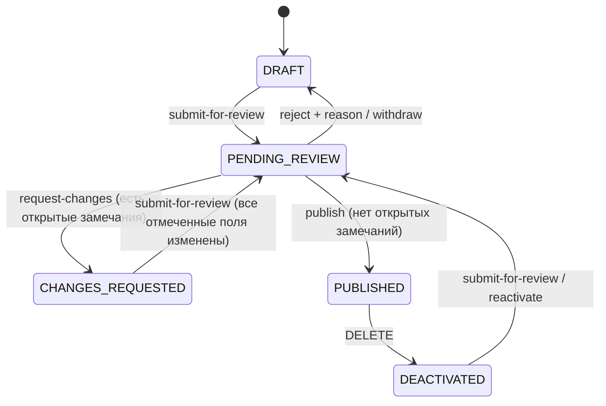

# Пошаговый редактор услуги и проверка по полям

Карточка услуги (`OrgFunction`) создаётся и редактируется в пошаговом редакторе, а рецензент проверяет её в тех же
разделах и оставляет замечания к конкретным полям. Существующий редакционный процесс
([function-editorial-workflow.md](function-editorial-workflow.md)) сохранён: черновые редакции опубликованных карточек,
`withdraw`, `reject` с причиной, деактивация, переводы и аудит работают как раньше.

## Шаги редактора

| Шаг (`editorStep`) | Поля | Обязательно при отправке на проверку |
|---|---|---|
| 1. Общие сведения (`general`) | название, описание, организация, категория, язык оригинала | название, описание, организация, язык |
| 2. Механизм оказания услуги (`mechanism`) | кто может воспользоваться, порядок действий, необходимые документы и детали каждого документа, срок, стоимость | — |
| 3. Цифровизация (`digitalization`) | способ получения (`profile.deliveryChannel`), ссылка на онлайн-услугу (`profile.onlineServiceUrl`), где и как подать заявление | ссылка, если услуга доступна онлайн |
| 4. Децентрализация и оценка рисков (`decentralization`) | уровень оказания (`profile.provisionLevel`), уровень риска (`profile.riskLevel`), оценка и меры (`profile.riskNotes`) | описание риска при уровне `HIGH` |
| 5. Прочие сведения (`other`) | дополнительные требования (`requirements`), внешняя ссылка (`officialSourceUrl`) | — |

Все прежние поля карточки сохранены и распределены по шагам. Новые поля шагов 3–4 (`profile`) — служебные: они
возвращаются только в ответах для сотрудников (`/admin`, `PUT`, переходы), никогда не попадают в публичные GET, памятку
PDF, выгрузки и отпечаток публичного содержимого и не переводятся.

- Шаг хранится в адресе (`?step=mechanism`), поэтому перезагрузка и ссылки из списка замечаний открывают нужный шаг.
- «Далее» проверяет обязательные и условные поля текущего шага; «Назад» и переход по степперу данные не теряют
  (все шаги — одна форма).
- «Сохранить черновик» доступен на любом шаге: требуются только название и организация (как и раньше для сервера).
  Сохраняется и `editorStep`, поэтому черновик без `?step=` открывается на шаге, с которого его сохранили.
- «Сохранить и отправить на проверку» (последний шаг) проверяет все шаги и открывает первый шаг и поле с ошибкой.
  Условные правила проверяет и сервер при `submit-for-review` (ответ `400` с `fieldErrors` `profile.*`).
- Защита от потери несохранённых изменений, проверка прав, переводы и черновые редакции не изменились.

## Статус «Требуются исправления»

Добавлен статус `CHANGES_REQUESTED` (миграция `V15`, CHECK-ограничения расширены). Он редактируемый, не публичный и
не является отказом: автор исправляет поля и отправляет карточку снова.

`reject` (возврат в черновик с обязательной причиной) сохранён без изменений; отдельного окончательного отказа в
системе нет. Черновая редакция может находиться в `CHANGES_REQUESTED` и может быть удалена из этого статуса.

## Замечания рецензента

Замечание привязано к устойчивому пути поля, а не к общей заметке:

- поле: `name`, `description`, `organizationId`, `categoryId`, `sourceLanguage`, `instructions.<поле>`,
  `profile.<поле>`, `requirements`, `officialSourceUrl`;
- весь шаг: `section.<шаг>`;
- один документ из «Деталей документов»: `documentDetails.<id>`. Каждая деталь документа получила устойчивый `id`
  (UUID; существующие детали получили его в миграции), он сохраняется при правках и перестановке строк, поэтому
  замечание остаётся у того же документа.

Таблица `function_review_comments`: карточка, путь, шаг, цикл проверки, текст (1–2000 символов, обязателен),
SHA-256 значения поля, которое видел рецензент, статус `OPEN`/`RESOLVED`, рецензент (id и e-mail снимком), время,
а при закрытии — способ (`ADDRESSED`, `REVIEWER_RESOLVED`, `REVISION_DISCARDED`), кто, когда и в каком цикле.
Строки не удаляются. На одно поле — не больше одного открытого замечания (частичный UNIQUE-индекс).

Правила:

1. Замечания добавляются, пока карточка `PENDING_REVIEW` (`FUNCTIONS_REVIEW`).
2. `request-changes` возможен только при открытых замечаниях; статус и запись аудита `REQUEST_CHANGES` (список полей
   и необязательный общий комментарий) сохраняются в одной транзакции.
3. Публикация (`publish`, `FUNCTIONS_PUBLISH`) отклоняется `409`, пока есть открытые замечания; в сообщении
   перечислены поля. Валидация сама по себе ничего не публикует.
4. Замечание считается исправленным, когда текущее значение поля отличается от того, что видел рецензент
   (сравнение на сервере). Повторная отправка возможна, только если исправлены все открытые замечания; при отправке
   они закрываются как `ADDRESSED` в той же транзакции, а цикл проверки увеличивается. Если автор не согласен с
   замечанием, рецензент может закрыть его явно (`REVIEWER_RESOLVED`).
5. При публикации или удалении черновой редакции её замечания и отметки переходят к опубликованной карточке;
   открытые замечания удаляемой редакции закрываются как `REVISION_DISCARDED`. Счётчик циклов не уменьшается.
6. Все действия с одной карточкой (замечание, отметка, запрос исправлений, отправка, публикация) берут блокировку
   строки (`SELECT … FOR UPDATE`), поэтому одновременные противоречивые решения невозможны: второе получает `409`.

Чек-лист рецензента — отметки «Раздел проверен» по каждому шагу в текущем цикле (`function_review_marks`). Кнопка
«Одобрить и опубликовать» в интерфейсе доступна, когда все пять разделов отмечены и открытых замечаний нет; сервер
обязательно проверяет только отсутствие открытых замечаний (отметки — вспомогательный список, а не правило API).

## Что видит автор

- Замечание показывается прямо над полем: блок «Замечания проверяющего», текст, рецензент и дата. Оно остаётся на месте,
  пока автор правит поле, и после сохранения помечается «Изменено после проверки».
- Редактор карточки в `CHANGES_REQUESTED` открывается на первом шаге с замечанием; степпер показывает число открытых
  замечаний на шагах. Панель «Замечания проверяющего» перечисляет все неисправленные замечания (переход к полю) и
  объясняет, когда можно отправить снова; «Отправить на проверку» неактивна, пока остались неизменённые поля.
- Закрытые замечания остаются в «Предыдущих замечаниях» с циклом, рецензентом, датой и способом закрытия, а события
  `REVIEW_COMMENT_ADD`, `REVIEW_COMMENT_RESOLVE`, `REQUEST_CHANGES` — в истории изменений карточки.
- В списке услуг у карточки с открытыми замечаниями показано их число.

## API

| Метод и путь | Право |
|---|---|
| `GET /api/functions/{id}/review` — замечания (с историей опубликованной карточки для редакции), отметки текущего цикла, `unaddressedFields`, `canResubmit` | `FUNCTIONS_VIEW` (в пределах организации) |
| `POST /api/functions/{id}/review/comments` `{fieldPath, comment}` | `FUNCTIONS_REVIEW` |
| `POST /api/functions/{id}/review/comments/{commentId}/resolve` | `FUNCTIONS_REVIEW` |
| `PUT` / `DELETE /api/functions/{id}/review/sections/{шаг}` | `FUNCTIONS_REVIEW` или `FUNCTIONS_PUBLISH` |
| `POST /api/functions/{id}/request-changes` `{summary?}` | `FUNCTIONS_REVIEW` |
| `POST /api/functions/{id}/submit-for-review` — теперь также из `CHANGES_REQUESTED` | `FUNCTIONS_SUBMIT_REVIEW` |
| `POST /api/functions/{id}/publish` — отклоняется при открытых замечаниях | `FUNCTIONS_PUBLISH` |

`POST /api/functions` и `PUT /api/functions/{id}` принимают необязательные `profile` и `editorStep`; `null` оставляет
текущие значения. Ответы для сотрудников содержат `profile`, `editorStep` и `review {cycle, openCorrections}`.
Новых прав не добавлено. `GET /api/functions/*/review` закрыт для анонимных запросов в `SecurityConfig`.

## Миграция и развёртывание

`V15__service_review_workflow.sql` только добавляет: статус в CHECK-ограничения, nullable-колонки профиля,
`editor_step`, `review_cycle` (карточкам в `PENDING_REVIEW` присваивается цикл 1), `id` существующим деталям
документов и две новые таблицы. Существующие строки не удаляются и не меняют статус. Порядок обновления: собрать и
запустить function-catalog-service (Flyway применит `V15`), затем фронтенд; reference-service при старте добавит
новые ключи интерфейса из каталога. Старый фронтенд с новым бэкендом продолжает работать (поля необязательны), но не
знает статус `CHANGES_REQUESTED`.

Сборку бэкенда выполняйте на JDK 17, как указано в README: Lombok из Spring Boot 3.5.4 не работает с JDK 25 (ошибки
`cannot find symbol` для геттеров).

## Проверки

- `ServiceReviewWorkflowPostgresTest` (PostgreSQL 16): профиль и шаг черновика, отсутствие профиля в публичном ответе,
  условные правила отправки, права на замечания/публикацию/запрос исправлений, дубликаты и пустые пояснения, блокировка
  одобрения, `CHANGES_REQUESTED`, правило повторной отправки, устойчивый id документа при перестановке, новый цикл,
  аудит, явное закрытие, доступ другой организации, перенос замечаний удалённой редакции.
- `front/tests/service-wizard.spec.ts`: сохранение и возобновление черновика на шаге, проверка шага и полной отправки,
  замечание с обязательным пояснением над полем, запрос исправлений, просмотр и исправление автором, новый цикл и
  история, блокировка одобрения, права, локализация на en/ru/uz/fr.
